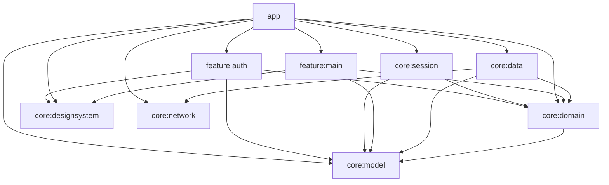

# Android 架构与工程约定

采用按业务拆分的 Gradle 多模块和分层单向依赖。企业工程没有唯一通用目录标准；本项目以边界可检查、依赖可替换、环境可隔离和构建可复现为落地准则。

## 模块职责

| 模块 | 职责 | 允许依赖 |
| --- | --- | --- |
| `app` | Application、Activity、变体配置、应用级依赖装配 | feature 和核心模块 |
| `feature:main` | 登录后首页、日期/概览状态、关于页和退出动作 | domain、model、designsystem |
| `feature:auth` | 原生认证页面、UiState、ViewModel、验证码交互 | domain、model、designsystem |
| `core:session` | Android Keystore 加密会话、原子文件存取 | domain、model；Android 库 |
| `core:designsystem` | Material 3 主题、品牌 token、未来通用 UI 组件 | Compose，禁止业务与网络依赖 |
| `core:domain` | 业务仓库接口；后续具有实际业务组合逻辑的 use case | model；纯 Kotlin |
| `core:model` | 领域模型、可枚举的业务结果与错误 | Kotlin 标准库 |
| `core:data` | 仓库实现、DTO 到领域模型转换、数据来源编排 | domain、model、network |
| `core:network` | Retrofit/OkHttp、序列化、API DTO | 第三方网络库；纯 Kotlin |
| `build-logic` | Android/JVM/Compose 约定插件 | Gradle、AGP、Kotlin 构建插件 |

图中列出允许的依赖方向，具体声明按实际需要添加。`checkModuleBoundaries` 会检查 Gradle 项目依赖白名单；新增 feature 时需同步更新检查规则。
feature 不依赖其他 feature 的实现；跨业务导航由 app 装配，路由入口作为模块公开 API。
禁止在 feature 引入 Retrofit、OkHttp 或数据实现类来绕过分层。

## 依赖注入与状态

当前采用构造函数注入，`app/di/AppContainer` 是唯一的应用级装配入口。仓库实现接收 API 接口，测试直接注入替身；禁止全局服务定位器和在 Composable 中构造客户端。
认证采用 ViewModel + StateFlow 暴露不可变 UiState，通过用户动作方法更新；Compose 使用生命周期感知方式收集状态。AppViewModel 管理会话恢复与认证流程的 ViewModelStore，旋转屏幕保留表单，登录完成或宿主销毁时清理认证状态。密码、验证码和验证码凭据不写入 SavedState 或磁盘。
`core:domain` 定义 AuthRepository 与 SessionStore；`core:data` 负责会话转换和续期互斥；`core:session` 用 Android Keystore AES-GCM 加密并原子写入 noBackupFilesDir。app 是 API、存储和仓库的装配入口。业务增长后可在 app 装配层引入 Hilt，领域契约保持不变。
图片、数据库模块按实际业务接入，不预装尚无消费方的 Room、DataStore 或 Coil。

## API 与异常

网络层 DTO 对齐现有 API 的 `code/message/data/meta` 包装。领域层只使用领域模型，不依赖 Retrofit 注解或 Android 类型。
HTTP 200 不等于业务成功；仓库同时验证 `code == OK` 和 data 内容。健康检查目前不消费 meta，序列化允许未知字段以兼容 API 扩展。
网络、HTTP、业务失败和无效响应分别映射；协程取消必须继续抛出，不能转成普通错误。
界面按领域错误显示中文提示，不向用户展示堆栈。Release 关闭接口日志；按当前调试要求，Debug 在本地 Logcat 明文输出请求和响应正文，包括认证字段，不写日志文件或远程上传。范围及读取上限见 [开发日志说明](../../docs/ANDROID-LOGGING.md)。
认证仓库通过 Mutex 串行化会话写入、刷新和清理，刷新失败区分凭据失效与暂时断网；后者保留刷新令牌并允许重试。保存/清理的磁盘与内存提交不可被协程取消拆开。详细行为和验收边界见 [登录说明](../../docs/ANDROID-AUTH.md)。

## 构建、环境与质量门禁

- Kotlin DSL + version catalog + convention plugins；模块只声明自身 namespace、功能开关和依赖。
- 所有依赖使用固定版本与 Gradle 锁文件，禁止动态版本和私有镜像隐式替换。
- app 的 dev/prod flavor 隔离接口和包名；Debug 自动追加后缀，Release 启用 R8 和资源压缩，不使用 Debug 签名。
- 网络策略与 Android 权限采用最小范围；关闭系统应用备份，防止后续认证和个人数据被默认备份。
- CI 执行模块依赖检查、JVM 回归、Android Lint、Debug/Release 构建；Lint 警告视为错误。仅将“存在更新版本”三类提示交由 Dependabot PR 审核，例外在 `lint.xml` 说明；不忽略代码、安全或资源诊断。
- 本地 SDK 路径、签名凭据、缓存和产物均被忽略。Gradle 工程独立于 pnpm workspace。
- 真机/模拟器 UI 验证与 JVM 测试分开记录。当前测试覆盖网络契约、仓库、ViewModel 和 Robolectric 本地 Compose UI；Android Keystore、手机键盘、邮件及第三方验证仍需真机联调。

## 新功能接入顺序

1. 确定接口字段、业务规则及页面设计。
2. 在 model/domain 定义实际需要的模型与仓库契约。
3. 在 network/data 实现请求、映射和回归测试。
4. 创建 `feature:<业务名>`，用 ViewModel/UiState 实现页面；状态型组件和展示组件分开。
5. app 装配依赖与导航；更新模块边界白名单和 CI 验证任务。
6. 通过静态检查、构建与自动化测试后，由用户完成真机验收。
