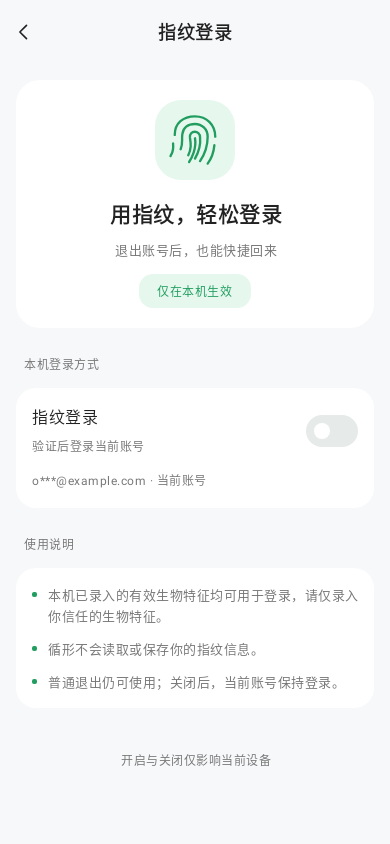
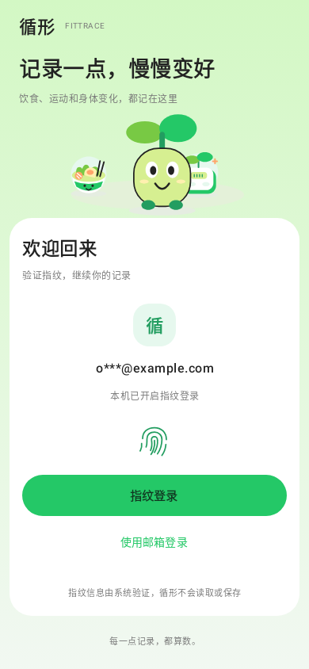

# Android 实现与验证 · 2026-10-23

已将本轮指纹设置和首页登录设计落实到原生 Compose，沿用当前 repository、Keystore 签名和服务端挑战流程。

- `BiometricScreen.kt`：分离设置、按需邮箱验证、指纹登录三个界面；复用 FitCard、FitTextField、FitNotice、FitDialog；设置通过开关主动开通和二次确认关闭。账号使用真实数据脱敏。
- `AuthBrandHeader.kt`：邮箱与指纹登录共用品牌文字和已有矢量插画，保持比例，软键盘展开时收起插画。新增指纹与返回图标使用可缩放 VectorDrawable。
- `AuthRoute.kt` / `BiometricRoute.kt`：保留邮箱、密码与找回入口；邮箱验证子页可返回设置，退出时清空验证码。
- `BiometricViewModel.kt`：保留错误类型和状态确认标志；网络失败不把本机开关改成已关闭；服务端拒绝凭据后，重新读取本地状态不会误恢复指纹主操作。
- `BiometricAuthenticator.kt`：系统窗使用“指纹验证”标题，去掉额外说明，设置 `setConfirmationRequired(false)` 请求省略验证后的额外确认；系统可能忽略该提示。图标、应用名称等系统元素不由页面控制，当前仅允许生物识别的接口仍要求取消入口。区分用户取消和系统锁定，继续要求强生物识别授权 CryptoObject；锁定时以邮箱作为恢复入口。

取消验证不自动重试。普通退出仍保留本机设备登录方式；关闭或本机移除复用原有接口。凭据失效时显示邮箱主操作，本机移除需要二次确认。验证码错误与网络错误分别使用字段和页面提示。

## 验证

运行 `./gradlew spotlessApply verify :app:assembleProdDebug --offline --no-configuration-cache --console=plain` 通过。

登录模块共 36 项测试通过，覆盖开通需主动操作、开关待确认、条件邮箱验证、关闭取消和确认、移除确认、失效恢复、系统锁定、重复点击保护、验证码长度约束与邮箱/密码回退。完整 `verify` 同时通过其他模块测试、Lint、格式与模块边界检查。构建结果为 `apps/android/app/build/outputs/apk/prod/debug/app-prod-debug.apk`。

已查看真实 Compose 组件的 Robolectric 渲染截图，包含 390px 浅色主稿、320px 深色及 1.3 倍字体的验证页面。截图没有用设计 SVG 替代应用页面；邮箱和验证码为测试数据。

| 设置未开启 | 指纹登录 |
| --- | --- |
|  |  |

本轮未安装或部署。真实设备传感器、Android 系统弹窗、系统软键盘与真实账号服务端联调仍需真机验收；本地 Compose 测试和 APK 构建不替代这些验收。

## 2026-10-30 收尾复核

应用页面品牌已统一为「循形Fitness」。历史设计源脚本、设计截图和验证记录保留原交付内容；SVG、manifest.json 和点击预览 HTML 可由 build.py 重新生成，已添加目录内忽略规则。

本次重新执行 `:feature:auth:testDebugUnitTest :feature:auth:lintDebug :app:assembleProdDebug spotlessCheck --offline` 通过。登录模块36项测试，失败、错误和跳过均为0；本次未重复执行完整 verify。未安装手机或部署，真实指纹传感器与账号端到端验收仍待完成。
